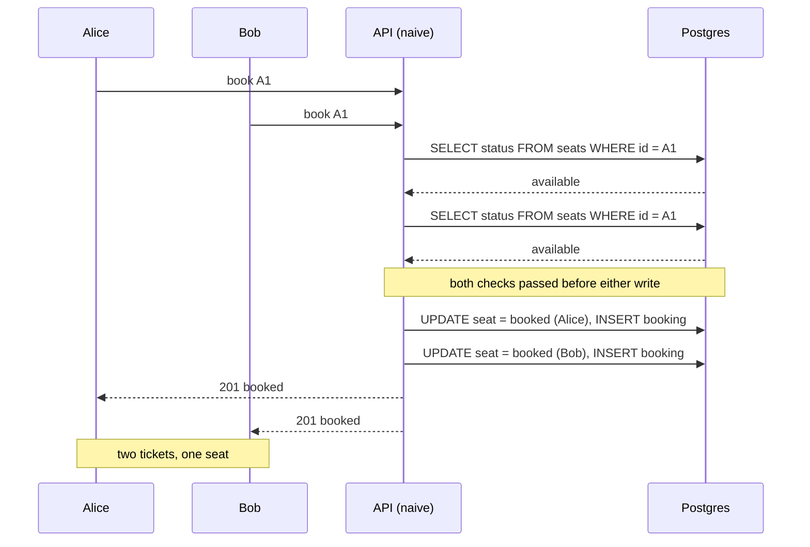
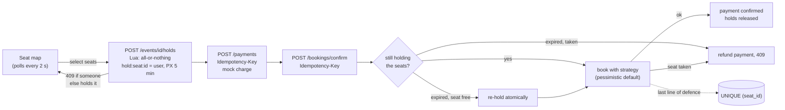

# SeatSentinel

Event seat booking, built to show one thing in depth: **concurrency and race
conditions**. A deliberately broken naive booking endpoint (with a test that
proves it double-books), three correct strategies (pessimistic, optimistic,
Redis lock) that each pass a 200-requests-for-one-seat test, seat holds with
a TTL, idempotent payments, and the database constraint underneath it all.

## What this project demonstrates

- **I can reproduce a race condition, not just describe one.** The naive endpoint is kept on purpose. Its test fires 200 concurrent requests at one seat, and 20 users are told they got it.
- **Three correct fixes, compared side by side:** pessimistic (`SELECT ... FOR UPDATE` with lock ordering and `lock_timeout`), optimistic (version column with bounded, jittered retries), and a Redis distributed lock (`SET NX PX` with a Lua owner-only release). Each gives exactly 1 × 201 and 199 × 409, and none ever returns a 500.
- **Defence in depth.** `UNIQUE (seat_id)` catches what application logic misses, and a test runs the broken code against the real table to prove it.
- **Real-world edge cases:** 5-minute holds in Redis that expire on their own; a payment that succeeds just after its hold expired (re-held if the seat is free, refunded if not); idempotency keys so 20 simultaneous retries charge exactly once.
- **Database fundamentals:** a runnable demo of READ COMMITTED (lost update) vs SERIALIZABLE (`40001`), and why I chose READ COMMITTED.
- **Load-tested:** throughput, p95 and double-booking counts per strategy, median of 3 runs, with contended and no-contention scenarios.
- **52 tests** against real Postgres and Redis, plus `DECISIONS.md` and `INTERVIEW.md`.

## Results

| Strategy | 200 users, 1 seat: winners | Double-booked under load | Throughput (contended) | p95 | When to use |
|---|---|---|---|---|---|
| naive (broken demo) | **2 to 20** | **3** | 328 req/s | 552 ms | Never |
| pessimistic `FOR UPDATE` | **1** | 0 | 377 req/s | 396 ms | Hot rows, high contention |
| optimistic `version` | **1** | 0 | 381 req/s | 402 ms | Rare conflicts, long think time |
| Redis `SET NX PX` | **1** | 0 | 367 req/s | 434 ms | Critical section spans systems |

Median of 3 runs, 2,000 bookings, 50 concurrent users, 0 server errors for
every strategy. No-contention numbers, method and caveats:
[docs/BENCHMARKS.md](docs/BENCHMARKS.md).

## The race condition



With `SELECT ... FOR UPDATE`, Bob's SELECT waits until Alice commits, then
sees `booked` and gets a 409. With a version column, Bob's
`UPDATE ... WHERE version = 0` matches 0 rows. With a Redis lock, Bob fails
at `SET NX` and never reaches Postgres. And if all of that had a bug,
`UNIQUE (seat_id)` on bookings rejects the second insert.

## The booking flow



## Run it

Requirements: Docker with Compose.

```bash
cp .env.example .env     # optional
docker compose up --build
```

| What | URL |
|---|---|
| Frontend (log in as `demo@seatsentinel.dev` / `demo1234`) | http://localhost:5172 |
| API docs (Swagger) | http://localhost:8002/docs |

Open the seat map in two browsers with two accounts to watch holds appear
on the other side within 2 seconds.

Try the race from the command line:

```bash
TOKEN=$(curl -s -X POST localhost:8002/auth/login -H 'content-type: application/json' \
  -d '{"email":"demo@seatsentinel.dev","password":"demo1234"}' | python -c 'import sys,json;print(json.load(sys.stdin)["access_token"])')
for strategy in naive pessimistic optimistic redis; do
  curl -s -X POST localhost:8002/book -H "Authorization: Bearer $TOKEN" -H 'content-type: application/json' \
    -d "{\"event_id\": 3, \"seat_ids\": [500], \"strategy\": \"$strategy\"}"; echo
done
```

## API

| Endpoint | Purpose |
|---|---|
| `POST /auth/signup`, `POST /auth/login` | JWT auth |
| `GET /events`, `GET /events/{id}/seats` | Events and seat map (free / held / booked) |
| `POST /book` `{event_id, seat_ids, strategy}` | Direct booking: `naive` (broken), `pessimistic`, `optimistic`, `redis` |
| `POST /events/{id}/holds`, `DELETE /events/{id}/holds` | Hold / release seats (5 min TTL) |
| `POST /payments` + `Idempotency-Key` | Mock charge for held seats |
| `POST /bookings/confirm` + `Idempotency-Key` | Turn a payment into a booking |
| `GET /bookings/me` | My bookings |

## Tests

52 tests against **real** Postgres and Redis:

- the naive endpoint double-books (200 concurrent requests, 20 winners)
- each correct strategy: 200 concurrent requests give exactly 1 × 201, 199 × 409, 1 row
- deadlock avoidance (`[1,2,3]` vs `[3,2,1]`), optimistic retry and give-up, pessimistic lock timeout
- Redis lock: owner-only release, auto-expiry, the stale-holder scenario the Lua script prevents
- holds: expiry, all-or-nothing, 100 concurrent holds → 1 winner
- idempotency: replay, 20 simultaneous retries → 1 charge, different body → 422
- late payment after hold expiry: rescued if the seat is free, refunded if taken
- READ COMMITTED vs SERIALIZABLE demo

```bash
docker compose exec api pytest -q
docker compose exec api python -m scripts.isolation_demo
docker compose exec api python -m benchmarks.load
```

## Docs

- [docs/BENCHMARKS.md](docs/BENCHMARKS.md): full comparison and caveats
- [docs/ISOLATION.md](docs/ISOLATION.md): READ COMMITTED vs SERIALIZABLE for this use case
- [docs/DECISIONS.md](docs/DECISIONS.md): every choice and its alternatives
- [docs/INTERVIEW.md](docs/INTERVIEW.md): 15 interview questions answered with this codebase

## Layout

```
backend/app/
  strategies/
    naive.py         BROKEN on purpose (check-then-act)
    pessimistic.py   SELECT ... FOR UPDATE
    optimistic.py    version column + retry
    redis_lock.py    SET NX PX + Lua release
    common.py        shared types, seat checks, booking insert
  holds.py           Redis holds with TTL (Lua, all-or-nothing)
  idempotency.py     Idempotency-Key handling (Postgres)
  checkout.py        charge + confirm, late-payment edge case, refunds
backend/scripts/     seed, isolation demo
backend/benchmarks/  load test + results
frontend/            React + Vite + Tailwind
```
